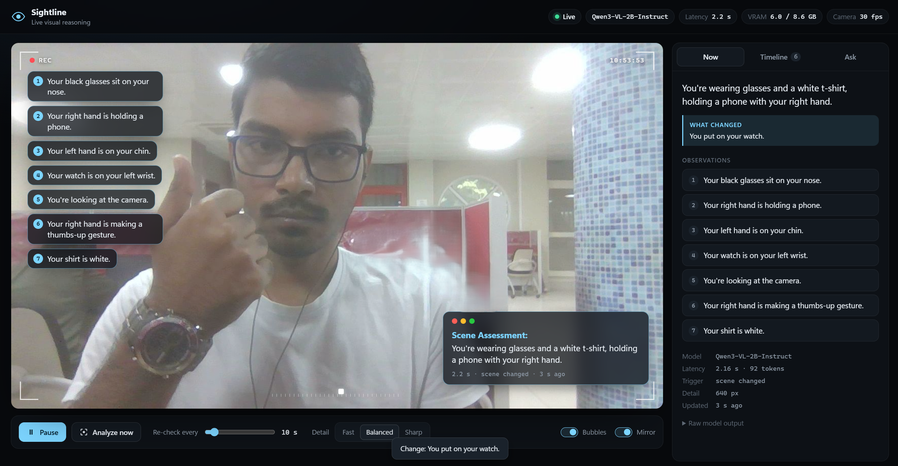

<div align="center">

# Sightline

**Live visual reasoning on your webcam with a local vision-language model**

[](https://www.python.org/)
[](https://pytorch.org/)
[](https://github.com/huggingface/transformers)
[](https://huggingface.co/Qwen/Qwen3-VL-2B-Instruct)
[](https://fastapi.tiangolo.com/)
<br>
[](#performance-notes-rtx-3070-ti-laptop-8-gb)
[](#run)
[](#sightline)
[](tests)
[](https://github.com/ai-avinashkp/VLM-Monitoring/commits/main)



</div>

A local vision-language model (Qwen3-VL-2B) watches your webcam and describes what it sees in
plain sentences, for example *"You're wearing black-framed glasses"* or *"Your right hand is on
your chin"*. It does not use fixed labels or confidence scores. It notices when something changes
and answers questions about the live frame. Everything runs on your GPU, and no frames leave the
machine.

The idea comes from the difference between traditional computer vision and vision-language models;
see the reference image and full design in [plan.md](plan.md).

## Run

```powershell
conda activate envPyTorch
cd D:\_Python\AL_ML\LLMs\Monitoring
python run.py
```

`run.py` does everything in order and reports each step in the terminal:

1. **System:** OS, CPU, GPU, PyTorch/CUDA versions, VRAM and RAM in use.
2. **Load model:** model name, load time, memory after loading.
3. **Warm up GPU:** compiles the decoder and runs test passes, so the first live frame is already
   fast (about 11 s normally; the very first run on a machine can take much longer).
4. **Camera:** resolution and fps.
5. **Web server:** starts only now, then prints `Ready. Open http://localhost:8000`.

Options: `--port 8001`, `--host 0.0.0.0`, `--model mock` (UI only, no GPU).

## Stop

Press **`Ctrl+C`** in that terminal. Shutdown runs in reverse and is logged:

1. Stop the web server (open video streams and live updates are closed).
2. Stop the reasoner (it finishes any model call in progress) and release the camera.
3. Offload the model from the GPU (VRAM goes from about 6.0 GB back to about 1.2 GB) and exit.

If that terminal is gone, this stops it from any PowerShell window. It skips the graceful steps,
but Windows still frees the GPU memory when the process ends:

```powershell
Get-CimInstance Win32_Process -Filter "Name='python.exe'" | Where-Object { $_.CommandLine -like '*run.py*' -or $_.CommandLine -like '*uvicorn*app.server*' } | ForEach-Object { Stop-Process -Id $_.ProcessId -Force }
```

`python -m uvicorn app.server:app --port 8000` also still works. It serves the page at once and
loads the model in the background.

## Using the page

- **Video stage:** numbered speech bubbles point at what each observation is about. The
  *Scene Assessment* card gives a one-line summary.
- **Now:** the full description, what changed, and the latency.
- **Timeline:** every change the model noticed, with a snapshot.
- **Ask:** questions about the current frame ("What am I holding?").
- **Controls:**
  - pause/resume (`P`) and analyze now (`A`)
  - how often to re-check
  - detail level (448 / 640 / 896 px sent to the model)
  - bubbles and mirror toggles

To work on the UI without a GPU, run `python run.py --model mock`.

## How it decides when to look
It re-describes the scene in three cases:
- when the picture has changed and you've been still for about 0.6 s
- every *Re-check* seconds, even if nothing changed (the heartbeat)
- when you press *Analyze now*

Questions jump the queue, even while paused. Thresholds are in `config.yaml`.

## Performance notes (RTX 3070 Ti Laptop, 8 GB)
| | Time |
|---|---|
| Summary on screen (streamed) | ~0.5–0.8 s |
| Each further bubble | +~0.5 s |
| Full description (~140 tokens) | ~1.7–3.2 s |
| "What changed" check (only when the scene changed) | +~0.6 s |
| Question | 0.6–1.3 s |
| VRAM | ~5.9 GB in use |

Two settings make this fast. Both are on by default:

- **`model.static_cache`:** the decode step is compiled into CUDA graphs (about 17 ms/token
  instead of about 150 ms/token). The **very first start compiles for a long time**; it took
  about 50 min here. The result is cached in `%TEMP%\torchinductor_<user>`, and later starts take
  about 35 s. If Disk Cleanup removes that folder, the next start compiles again.
- **`server.boost_cpu`:** pins the process to the performance cores with high priority. Without
  it, Windows may run the decode loop on an efficiency core, and the starved GPU clocks down.

## Other models
Set `model.id` in `config.yaml`:
- `Qwen/Qwen3.5-2B` gave similar-quality descriptions, but takes about 7.5 s without the compiled
  path. It needs the `flash-linear-attention` package for its fast kernels.
- A 4B model needs `quantize_4bit: true` to fit.

## Scripts and tests
```powershell
python scripts/check_camera.py                    # can the webcam be opened?
python scripts/describe_once.py --ask "Am I wearing a mask?"
python scripts/bench_vlm.py --images a.jpg b.jpg  # compare models
python -m pytest tests
```
