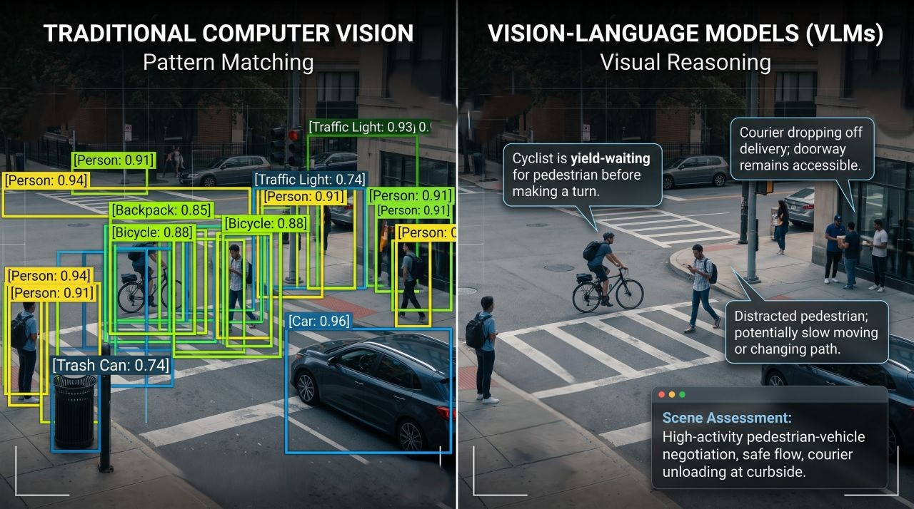

# Plan: Live Webcam Visual Reasoning (VLM) Monitor

> This is the original design and progress log. Environment details and measurements refer to the
> author's development machine (RTX 3070 Ti Laptop GPU, i7-12650H, Windows 11). For installing and
> running the project, see [README.md](README.md).

## 1. Goal

Build the **right-hand side** of the reference image below: a live webcam system that
*reasons about* what it sees and describes it in natural language, instead of drawing fixed-class
boxes with confidence scores.

<p align="center">
  
  <br>
  <em>Reference: traditional computer vision (left: pattern matching, fixed labels and scores) vs.
  vision-language models (right: visual reasoning in sentences). This project builds the right side.</em>
</p>

Initial target scene: **me in front of the webcam**. The system should say things like:

> "You're wearing rectangular black-framed glasses and a light-blue surgical mask pulled down below
> your nose. You're holding a phone in your right hand and looking at it rather than the screen."

…not `[person: 0.94] [glasses: 0.81]`.

### What "not strict words" means here
- No fixed label set or class list. The model describes freely: accessories (glasses, mask,
  headphones, cap), how they're worn (mask under the nose, glasses pushed up), objects held,
  activity, posture, gaze, expression, lighting, and so on.
- **Changes over time** are described in words too: "You just took your glasses off."
- You can **ask a question** in plain words ("is my mask covering my nose?") and get a free-form answer.
- No alert or watch-rule system. This was dropped on 2026-10-23.

### Non-goals (for now)
- Training or fine-tuning any model.
- Multiple cameras, multiple people, or face identity / recognition.
- Cloud APIs. Everything runs **locally** on the GPU, and no frames leave the machine.

---

## 2. Author's development environment (verified 2026-10-22)

| Item | Value |
|---|---|
| Conda env | the author's existing PyTorch env (Python 3.10.20) |
| GPU | NVIDIA RTX 3070 Ti Laptop, **8 GB VRAM** |
| torch / CUDA | 2.11.0+cu128, CUDA available ✅ |
| transformers | 5.14.1 (supports Qwen-VL / SmolVLM via `AutoModelForImageTextToText`) |
| accelerate / bitsandbytes | 1.14.0 / 0.49.2 (4-bit quantization possible) |
| Web stack | fastapi 0.141, uvicorn 0.52, websockets 16.1, python-multipart ✅ |
| Misc | opencv-python-headless 5.0, Pillow 12.3, ImageHash 4.3, PyYAML 6.0, numpy 2.2 |
| VLMs in HF cache | none, so the first run downloads weights |

**Important constraints from the environment**
- OpenCV is the **headless** build, so `cv2.imshow` won't work. The UI therefore runs **in the
  browser** (FastAPI + MJPEG stream + WebSocket). This also makes the "speech bubble" overlay from
  the image easy to do in HTML/CSS. `cv2.VideoCapture` still works in headless.
  Don't install `opencv-python` alongside it, because the two packages conflict.
- 8 GB VRAM means one VLM loaded at a time, kept to about ≤ 5 GB so there's headroom for activations.
- Windows: use the `cv2.CAP_DSHOW` (or `CAP_MSMF`) backend. flash-attn isn't available, so use `attn_implementation="sdpa"`.
- Expected new dependencies: **none required**. `qwen-vl-utils` is optional. Avoid changing package
  versions in the author's shared env.

---

## 3. Model choice

All models sit behind a single `VLM` interface, so switching is a config change. **Phase 0 benchmarks
these on the author's GPU and picks the default** based on latency and description quality.

| Role | Candidate | Precision | Est. VRAM | Why |
|---|---|---|---|---|
| **Default** | `Qwen/Qwen3-VL-2B-Instruct` | bf16 | ~5 GB | Strong detail and reasoning for its size, can output boxes (grounding) for anchored bubbles |
| Newer contender | `Qwen/Qwen3.5-2B` | bf16 | ~5 GB | Newer natively multimodal Qwen. Run with thinking turned off |
| Quality mode | `Qwen/Qwen3-VL-4B-Instruct` | 4-bit NF4 | ~4 GB | Better reasoning, slower |
| Fallback | `Qwen/Qwen2.5-VL-3B-Instruct` | bf16 / 4-bit | ~4–7 GB | Mature, well-documented grounding |
| Speed mode | `HuggingFaceTB/SmolVLM2-2.2B-Instruct` | bf16 | ~5 GB | Fast captions, weaker on fine detail |

VRAM figures are estimates to confirm in Phase 0. Before downloading, check the Hub for newer small
instruct VLMs (≤ 4B) released since these. The interface makes adding one cheap.

**Latency levers:**
- Cap image size (`max_pixels` ≈ 448×448 to 640×480) to limit visual tokens.
- Keep `max_new_tokens` around 120–200.
- Use greedy or low-temperature decoding.
- Run one inference at a time, always on the *latest* frame.
- Warm up the model once at startup.

Target: **≤ 3 s per reasoning update**. The video itself stays at full frame rate because it
doesn't wait on the model.

---

## 4. Architecture

Two loops run at different speeds, mirroring the image: the video plays smoothly while the
"reasoning" updates every few seconds.

```
 ┌───────────────┐   latest frame    ┌──────────────────────────────┐
 │ Camera thread │ ───────────────▶  │ FrameBuffer (1 slot, locked) │
 │ (cv2, ~30fps) │                   └──────┬───────────────┬───────┘
 └───────────────┘                          │               │
                                            │               ▼
                                            │      ┌─────────────────┐  MJPEG  ┌──────────────┐
                                            │      │ /stream endpoint│ ──────▶ │              │
                                            │      └─────────────────┘         │   Browser    │
                                            ▼                                  │  video +     │
                         ┌──────────────────────────────────┐   WebSocket     │  bubbles +   │
                         │ Reasoner thread                  │ ──────────────▶ │  assessment  │
                         │ 1. ChangeDetector: skip if same  │   JSON updates  │  panel +     │
                         │ 2. build prompt (+ prev state,   │                 │  event log + │
                         │    + user question)              │ ◀────────────── │  ask box     │
                         │ 3. VLM.generate()  (GPU)         │   /ask          └──────────────┘
                         │ 4. parse → Observation JSON      │
                         │ 5. diff vs prev → events         │
                         └──────────────────────────────────┘
```

### When the VLM runs
1. **Scene changed:** perceptual-hash / pixel-diff distance on a downscaled grayscale frame goes
   above a threshold, after a short debounce so motion has settled.
2. **Heartbeat:** at least every N seconds (e.g. 10 s), even if nothing changed.
3. **User question:** an `/ask` request jumps the queue.
4. Never more than one inference in flight. If the model is busy, it only ever takes the newest frame.

### VLM output contract (free text inside a light structure)
The model is asked for JSON. The *values* are free natural language, not labels:

```json
{
  "summary": "One-sentence scene assessment, like the 'Scene Assessment' box.",
  "observations": [
    {"text": "Wearing black rectangular glasses", "region": [x1, y1, x2, y2]},
    {"text": "Surgical mask pulled down under the chin", "region": null}
  ],
  "changes": "Compared with before: took off headphones."
}
```
- `region` is optional and only used once grounding is enabled (Phase 5). Coordinates are
  normalized to the frame.
- Parsing must be tolerant: extract the first JSON object, repair common issues, and **fall back to
  showing raw text** if parsing fails. A bad parse should never crash the loop.
- The previous `summary`/`observations` are passed back in the prompt, so the model can describe
  *changes* and keep its wording stable across updates.

### Prompt principles
- Role: "You are watching a live webcam of one person at their desk."
- Describe only what is **clearly visible**. Say "unclear" rather than guess, and never invent
  identity, age, or emotion beyond the obvious.
- Prefer specific, concrete descriptions (color, style, how an item is worn) over generic nouns.
- No confidence numbers and no label lists. Write natural sentences.
- Keep it short: at most about 5 observations.

---

## 5. Project structure

```
VLM-Monitoring/                # project root
├── run.py                     # entry point: load + warm model, open camera, serve; Ctrl+C shuts down in reverse
├── config.yaml                # camera, model, change-detection and server settings
├── requirements.txt           # dependencies (install a CUDA build of PyTorch first)
├── README.md                  # setup and usage
├── plan.md                    # this design and progress log
├── docs/
│   ├── reference-cv-vs-vlm.jpg  # the reference image (traditional CV vs. VLM)
│   └── ProjectPage.png          # screenshot of the app
├── app/
│   ├── config.py              # load/validate config.yaml
│   ├── camera.py              # threaded capture, newest-frame buffer, reconnect on failure
│   ├── change.py              # ChangeDetector (downscaled block diff + settle time)
│   ├── prompts.py             # system prompt; describe / what-changed / ask templates
│   ├── parsing.py             # tolerant JSON parsing, incl. partial (streaming) replies
│   ├── reasoner.py            # worker thread: when to look, describe, compare frames, answer questions
│   ├── state.py               # shared state + WebSocket broadcaster
│   ├── lifecycle.py           # system/memory report, model load, warm-up, offload
│   ├── perf.py                # P-core pinning + process priority
│   ├── server.py              # FastAPI: / , /stream (MJPEG), /ws, /api/ask, /api/control, /api/health
│   ├── vlm/
│   │   ├── base.py            # VLM protocol: generate(image(s), system, prompt, ...) -> Generation
│   │   ├── hf_vlm.py          # transformers backend (static cache, streaming, early stop)
│   │   └── mock.py            # fake VLM for UI / tests without a GPU
│   └── static/                # index.html, app.js, style.css (the browser UI)
├── scripts/
│   ├── check_camera.py        # open the webcam, report resolution/fps, save one frame
│   ├── bench_vlm.py           # compare candidate models on sample images
│   └── describe_once.py       # describe one frame (or answer one question) in the terminal
└── tests/                     # pytest: parsing, change detection, reasoner (mock VLM)
```

Run from the project root with `python run.py`, then open http://localhost:8000 (see README.md).

---

## 6. Phases

### Phase 0: Smoke tests and model pick
- `scripts/check_camera.py`: confirm the webcam opens (try DSHOW, then MSMF) and record its
  resolution and fps.
- `scripts/bench_vlm.py`: for each candidate model, record load time, peak VRAM
  (`torch.cuda.max_memory_allocated`), and median latency over 5 runs at 2 image sizes. Use a few
  test photos of me: with and without glasses, with and without a mask, with headphones, holding a phone.
- Read the outputs side by side and **pick the default model and image size**.

**Done when:** the camera works, one model gives correct descriptions in ≤ 3 s, and the results
table is added to this file.

### Phase 1: Single-shot reasoning (terminal)
- `app/vlm/*` (HF backend + mock), `prompts.py`, `parsing.py`.
- `scripts/describe_once.py`: capture a frame, print the parsed summary and observations.

**Done when:** I put on or take off glasses and a mask, and the descriptions are correct and specific.

### Phase 2: Live web app (MVP)
- `camera.py` (threaded), `reasoner.py` (heartbeat-only trigger at first), `server.py`, static UI.
- **UI layout**, a dark "camera HUD" look taken from the reference image:
  - **Top bar:** app name, a live/paused status, model name, last latency, VRAM in use, and
    "updated N s ago".
  - **Main stage:** the live video with viewfinder corner brackets, a REC dot, and the timestamp.
    The latest observations float over the video as glass-style speech bubbles, and a
    **Scene Assessment** card with traffic-light dots sits bottom-right, as in the image.
    A scan line runs while the model is thinking.
  - **Control strip under the video:** pause/resume analysis, "Analyze now", a heartbeat-interval
    slider, a bubbles on/off toggle, and image-size choices.
  - **Sidebar tabs:**
    - *Now:* the full observation list and a "what changed" note.
    - *Timeline:* timestamped change events with frame thumbnails.
    - *Ask:* a chat thread and input box.
  - Responsive: on narrow screens the sidebar stacks under the video.

**Done when:** video is smooth at about 30 fps, reasoning updates arrive continuously, and the app
survives a camera unplug/replug.

### Phase 3: Smart triggering and temporal awareness
- `change.py`: run only on meaningful change or on the heartbeat.
- Pass the previous state into the prompt, fill in `changes`, and keep a timestamped **event log**
  in the UI ("14:32:10 — put on mask").

**Done when:** GPU is idle while I sit still, and change events show up within about 3 s of me
doing something.

### Phase 4: Ask
- **Ask box:** "What am I holding?" or "Is my mask covering my nose?" gets a free-form answer about
  the current frame. Questions jump ahead of the next scheduled update.
- Answers appear in a chat-style thread in the sidebar, each with a thumbnail of the frame it
  answered about.

**Done when:** questions about what I'm wearing or holding get correct, specific answers within about 3 s.

### Phase 5: Anchored speech bubbles (grounding)
- Ask Qwen-VL for `region` boxes per observation, then draw callout bubbles with a pointer line to
  each region, styled like the image.
- Keep bubble positions stable between updates: match by text similarity and smooth the positions.

**Done when:** bubbles point at the right things (face → glasses, hand → phone).

### Phase 6: Polish and stretch goals
- Settings panel: model, interval, image size, prompt style.
- Optional "compare" mode: a YOLO box view next to the VLM view, recreating the whole image.
  This would need `ultralytics` added.
- Session export: event log as JSON or CSV.

---

## 7. Testing and evaluation
- **Unit tests** (no GPU): parsing edge cases (code-fenced JSON, trailing text, invalid JSON →
  fallback), change-detector thresholds, and reasoner trigger/debounce logic with the mock VLM.
- **Manual eval script:** about 10 scripted actions (glasses on/off, mask on / under nose / off,
  headphones, cap, phone, cup, looking away, leaving the frame, low light). For each, note whether
  it was **correct**, **specific**, and **noticed as a change**.
- Track latency and VRAM per model in a small table in this file.

## 8. Risks and mitigations

| Risk | Mitigation |
|---|---|
| Hallucinated details | "Only clearly visible" prompt, low temperature, show staleness ("as of 3 s ago") |
| Latency too high | Smaller image or model, change-triggering, SmolVLM speed mode |
| VRAM out-of-memory | One model at a time, 4-bit for models ≥ 4B, cap `max_pixels`, `torch.inference_mode()` |
| Model returns invalid JSON | Tolerant parser with a raw-text fallback; never crash the loop |
| transformers 5.x API drift | Use the generic `AutoModelForImageTextToText` + `AutoProcessor` with `apply_chat_template`, and verify in Phase 0 |
| Webcam busy or wrong index on Windows | Backend fallback (DSHOW → MSMF), index in config, auto-reconnect |
| Breaking the author's shared conda env | Don't change installed versions. Any new package is noted here first |
| Privacy | Fully local, no frames written to disk unless debug saving is explicitly turned on |

## 9. Open decisions (defaults chosen; can change)
- **UI:** browser (FastAPI). The env has headless OpenCV and the bubble overlay is easier in HTML.
- **Default model:** Qwen3-VL-2B-Instruct, pending the Phase 0 benchmark.
- **Update cadence:** on change, plus a heartbeat every 10 s.

---

## 10. Status and results (2026-10-23)

**Built:** Phases 0–5. The app runs with `python run.py` from the project root (see README).
**Not done:** Phase 6, plus the manual action-by-action evaluation from §7. Mask cases haven't been
tested yet because no mask was on camera.

### Phase 0 measurements (RTX 3070 Ti Laptop, live 1280×720 frames, image side 640)

| Model | Decode path | Full describe | Ask | ms/token | VRAM in use | Notes |
|---|---|---|---|---|---|---|
| **Qwen3-VL-2B-Instruct** (default) | static cache, CUDA graphs | **3.7–4.1 s** | 0.6–1.3 s | ~17–19 | ~5.9 GB | Correct: glasses, white t-shirt, hand on chin, earphones, watch. Good boxes |
| Qwen3-VL-2B-Instruct | dynamic cache, P-core pinned | ~14 s | | ~67 | | |
| Qwen3-VL-2B-Instruct | dynamic cache, default | ~20 s | | ~150 | | GPU 6–27% busy, down-clocked to 405 MHz |
| Qwen3.5-2B | dynamic cache, P-core pinned | 7.5 s | 0.8 s | ~53 | ~5.6 GB | Equally accurate, slightly more specific wording. Static cache not tried (would need another long compile); fast kernels need `flash-linear-attention` |

### Things learned along the way
- **Decoding is limited by CPU launch speed on the author's laptop.** Each token launches about 2,000
  small kernels. When the GPU is starved it clocks down, which makes every kernel slower too.
  Two fixes:
  - compiled CUDA-graph decode (`static_cache`): about 9× faster
  - pinning to P-cores with high priority: about 2× faster without compiling
- **First compile is slow.** It took about 50 min on the author's laptop; the inductor cache in
  `%TEMP%\torchinductor_<user>` brings later starts down to about 35 s from launch to first scene.
- **Assistant prefill** `{"summary": "You` stops markdown fences and third-person wording
  ("A man in a white shirt…" became "You're wearing…").
- **Change detection.** Normal movement scores 40–80 on the block-change metric, so the threshold
  went from 14 to 22 and the minimum gap to 2 s. These may still need tuning in daily use.

### Latency pass (2026-10-25)
- 94% of the time was generating output tokens (17 ms each), with prefill at 0.2 s; image size
  barely mattered. Qwen writes each digit as its own token, so one box cost about 24 tokens.
- **Compact format:** `["detail", x1, y1, x2, y2]`, with 3–4 observations, cut a description
  from ~200 to ~140 tokens.
- **Streaming:** the summary appears at ~0.5–0.8 s and bubbles fill in one by one (~0.5 s apart).
  A full description takes 1.7–3.2 s, down from 3.7–5 s.
- **Previous description removed from the prompt.** With it, the 2B model copied it, stopped
  returning boxes and fell into repetition loops. "What changed" is now a separate before/after
  comparison of the two frames (~0.4 s), run only when the scene really changed. A yes/no check
  then rejects claimed additions that were already there. On test pairs, false claims went from
  4/6 to 1/6, but **removals are mostly missed** (reported as no change). A bigger model would help.
- **Prompt wording was chosen by measurement:** variant A grounded 18/23 details, other variants
  6–13. Field order matters, and moving "changes" before "observations" killed grounding.
- Loop guard: generation stops at 5 observations or on the first repeated one.
